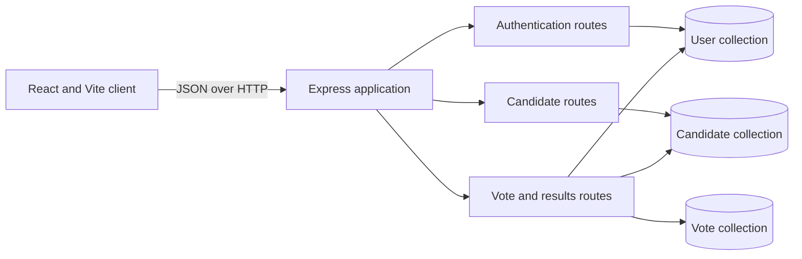

# SecureVote Architecture

## Scope

SecureVote is a browser-based demonstration application. The React client calls a single Express API, which uses MongoDB through Mongoose. The repository contains one configured election identifier (`college-election-2026`) for vote submission and result queries.

## Component map

- `client/src/App.jsx` owns the browser workflow and calls the API.
- `server/server.js` configures CORS, JSON parsing, route mounts, health endpoints, and startup.
- `server/routes/authRoutes.js` handles voter registration and login.
- `server/middleware/authMiddleware.js` verifies JWT signature, issuer, audience, and expiration before adding the token subject and role to `req.user`.
- `server/routes/candidateRoutes.js` lists candidates to authenticated users and restricts candidate creation to the admin role.
- `server/routes/voteRoutes.js` handles vote submission, status, and admin results.
- `server/models/` defines persisted users, candidates, and votes. The vote model has a unique compound index on voter and election.

## Main request flows

### Registration and login

Registration trims and validates name/email, enforces the password length accepted by bcrypt, hashes the password, and creates a voter account. Login looks up the normalized email, compares the password hash, and issues a short-lived JWT with the configured issuer and audience. Login requests pass through an in-memory rate limiter.

### Candidate administration

Candidate listing requires a valid JWT. Creating a candidate additionally requires the token role `admin`, validates the submitted fields, and stores the candidate. The browser displays candidate management to admin users.

### Vote submission

The API validates the candidate identifier, starts a MongoDB session and transaction, confirms that the candidate belongs to the configured election, atomically changes the voter’s `hasVoted` state, and inserts the vote. A unique voter/election database index provides a second duplicate-vote constraint. Results aggregate votes by candidate and return counts without voter IDs.

## Data and trust boundaries

- The browser and API communicate using JSON and bearer tokens. A client-side role check only controls presentation; the server route checks enforce access.
- JWT verification uses `JWT_SECRET`; the secret must be configured privately in the server environment.
- Password hashes are excluded from normal user queries and are selected explicitly for login comparison.
- `Vote` records include both `voterId` and candidate ID. The results response omits voter IDs, but the stored vote records are linkable to voters by database operators.
- Vote transactions require MongoDB transaction support, typically a replica set.
- The code’s election identifier is a constant in the vote routes, while the candidate schema supports an election ID. Candidate administration must keep candidates aligned with the configured election.

## Operational entry points

- `GET /api/health` reports that the API process responds.
- `GET /api/db-status` reports the current Mongoose connection state and database name.
- `server/db.js` reads `MONGO_URI`; absent configuration falls back to a local `securevote` database.
- `server/package.json` provides the backend start and test commands.

See [API Reference](API.md) for route details and [Security Notes](SECURITY.md) for controls and limitations.
